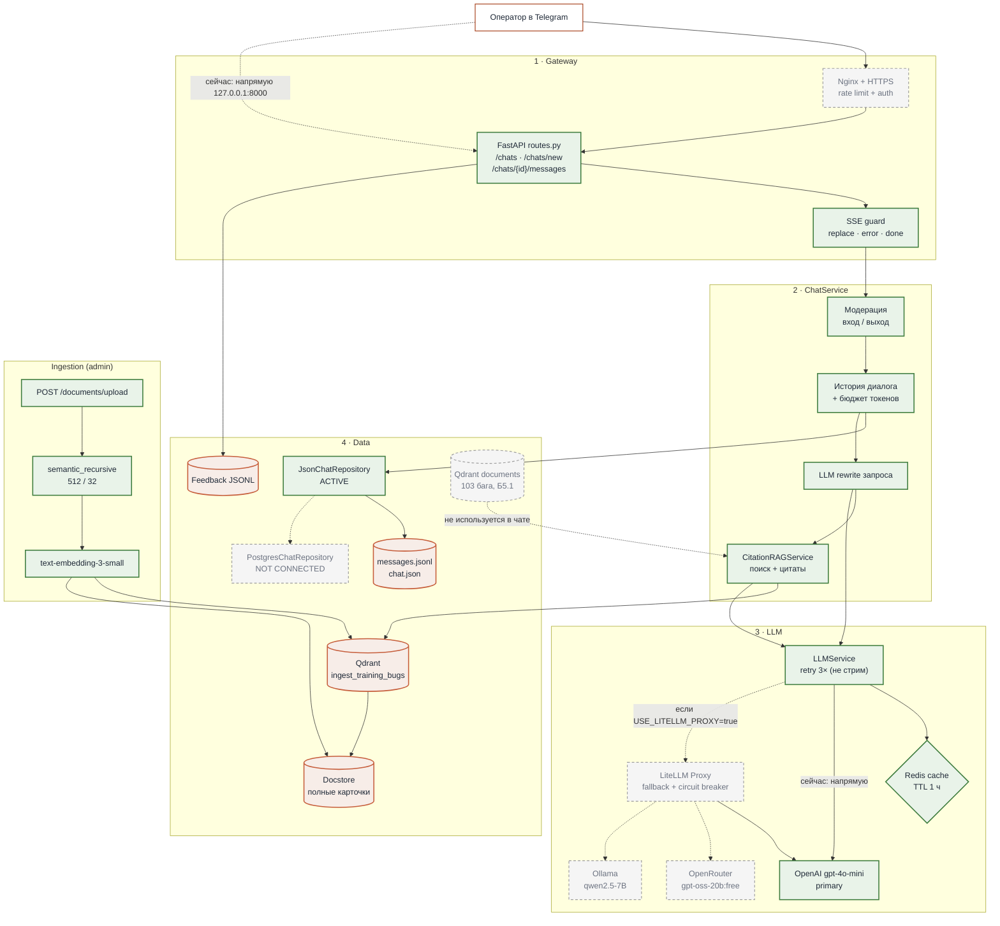
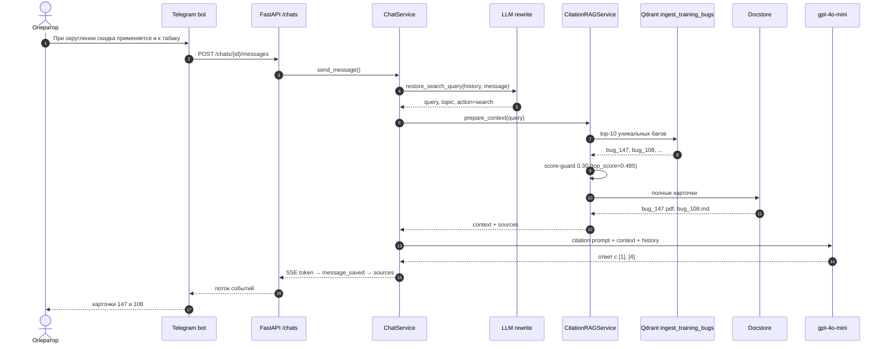

# Final_bag_assistant_project
Дипломный проект "Баг-ассистент операторов техподдержки"

BAG-ассистент для операторов первой линии: по обращению клиента находит известные баги и возвращает карточку с номером, названием, статусом, причиной и временным
решением. Работает как Telegram-бот, backend — FastAPI, поиск — Qdrant, генерация — `gpt-4o-mini`.

Ассистент не консультирует клиента и не придумывает баги, сроки или решения.
Ответственность за ответ клиенту остаётся у оператора.

## Что умеет

- Искать баги по тексту в любой формулировке, включая опечатки и разговорные описания.
- Принимать голос, PDF и DOCX: голос распознаётся через Whisper, из документов извлекается текст, дальше выполняется тот же поиск.
- Понимать уточнения: «А для них?» продолжает предыдущую проблему, не запускает поиск с нуля.
- Держать несколько сессий: `/new` создаёт новый `chat_id`, `/clear` очищает историю текущей сессии.
- Сохранять оценку 👍/👎 вместе с источниками, которые были в ответе.
- Честно отказывать: если подходящих багов нет, ответ — «Подходящих багов не найдено».
- Принимать новые карточки через административный `POST /documents/upload`.

### Команды бота

| Команда | Действие |
|---|---|
| `/start` | приветствие, создание или получение текущего чата |
| `/clear` | очистить историю текущей сессии |
| `/help` | справка по командам |
| `/stats`, `/users`, `/broadcast` | только для ID из `BOT_ADMIN_IDS` |

## Сценарии использования

1. **Текстовое обращение.** Оператор копирует сообщение клиента в бота и получает список релевантных багов с временными решениями.
2. **Голос или документ.** Оператор отправляет голосовое, PDF или DOCX — бот извлекает текст и ищет баги по нему.
3. **Уточнение.** После ответа оператор пишет «А для них?» или добавляет условие — бот сохраняет контекст и не теряет предыдущую проблему.
4. **Новая сессия.** `/clear` очищает историю текущего диалога, `/new` создаёт отдельный чат (пока не попало в последнюю сборку). 
5. **Обратная связь.** Оператор ставит 👍/👎; оценка и источники сохраняются в JSONL для последующего разбора.
6. **Пополнение базы.** Администратор загружает новую карточку `bug_<id>.md` или `bug_<id>.pdf`, ingestion индексирует её в фоне.

## Архитектура

Четыре слоя: Gateway, ChatService, LLM и Data. Зелёный — работает в текущей сборке, серый пунктир — подготовлено, но не включено или запланировано.



Полная схема: [`docs/architecture-final.mmd`](docs/architecture-final.mmd).

## Как работает поиск

1. Сообщение оператора проходит модерацию входа.
2. `restore_search_query` через LLM переписывает сообщение в самостоятельный поисковый запрос, сохраняя `topic` и выбирая действие: `search`, `repeat` или `ignore`.
3. `CitationRAGService.prepare_context` считает embedding запроса моделью `text-embedding-3-small` (1536 измерений).
4. Qdrant ищет по коллекции `ingest_training_bugs`; из чанков выбираются top-10 **уникальных багов** по лучшему чанку.
5. Если лучший score ниже `RAG_SCORE_THRESHOLD=0.30`, модель генерации не вызывается — сразу возвращается отказ.
6. Полные карточки найденных багов загружаются из docstore, чтобы временное решение не обрезалось.
7. До 5 карточек передаются в `gpt-4o-mini` вместе с citation prompt.
8. Ответ стримится в Telegram; в конце приходят `sources` — источники с `citation_id`, `file_name`, `page`, `score`.

Параметры индексации: `semantic_recursive`, chunk size 512, overlap 32, метрика `COSINE`. Рабочий корпус — 54 документа (28 Markdown + 26 PDF, около 1,5 МБ) в `data/training_bugs`. Манифест `export_manifest.json` фиксирует первичный экспорт 50 файлов; ещё 4 добавлены позже.

> `QDRANT_COLLECTION=documents` — отдельная базовая коллекция на 103 карточки
> (Б5.1). Чат ищет не по ней, а по `INGEST_COLLECTION=ingest_training_bugs`.

## Почему RAG, а не агент

Задача — один поиск и фиксированный формат ответа. Агенту здесь нечего планировать, зато он добавляет цену, задержку и непредсказуемость.

Сравнение на 5 задачах: multi-agent дал 80% качества против 100% у управляемого RAG, потратил в 1,7 раза больше токенов и был в 1,19 раза медленнее. Поэтому выбран фиксированный RAG-пайплайн, а не агентный граф.

## Быстрый старт (Docker Compose)

Нужны Docker Desktop, ключ OpenAI и токен Telegram-бота.

```bash
cp .env.example .env
```

Заполните в `.env` минимум:

```dotenv
LLM__OPENAI_API_KEY=sk-...
EMBEDDING_OPENAI_API_KEY=sk-...
QDRANT_API_KEY=...
BOT_TOKEN=...
INTERNAL_TOKEN=...
POSTGRES_DB=bag_assistant
POSTGRES_USER=bag_assistant
POSTGRES_PASSWORD=...
```

`docker-compose.yml` не стартует без `QDRANT_API_KEY`, `BOT_TOKEN`,
`INTERNAL_TOKEN` и `POSTGRES_*`: они помечены как обязательные.

Запуск:

```bash
docker compose up -d --build
docker compose ps
docker compose logs -f app
docker compose logs -f bot
```

Проверка:

```bash
curl http://127.0.0.1:8000/health
curl http://127.0.0.1:8000/ready
```

Сервисы:

| Сервис | Адрес |
|---|---|
| Backend / Swagger | http://127.0.0.1:8000/docs |
| Telegram-бот | работает через Bot API, HTTP-порт `:9000` |
| Qdrant | http://127.0.0.1:6333 |
| Phoenix (трейсы) | http://127.0.0.1:6006 |
| Redis | внутри compose, наружу не проброшен |
| PostgreSQL | внутри compose, приложением пока не используется |

При каждом старте контейнер `app` выполняет инкрементальную индексацию `scripts/ingest.py data`. Первый запуск на 54 документах может занять несколько минут, поэтому у healthcheck большой `start_period`.

Остановка:

```bash
docker compose down
```

`docker compose down -v` удалит тома Qdrant, Redis, Phoenix и историю чатов — после этого корпус нужно проиндексировать заново.

## Локальный запуск (uv)

Альтернатива Docker — запустить инфраструктуру в контейнерах, а приложение локально.

```bash
docker compose up -d qdrant redis phoenix
```

В отдельном терминале:

```bash
uv sync --extra tracing
uv run python scripts/ingest.py data --check
uv run python scripts/ingest.py data
uv run uvicorn app.main:app --reload
```

В отдельном терминале:

```bash
uv run python -m bot
```

В `.env` для локального запуска укажите:

```dotenv
QDRANT_URL=http://127.0.0.1:6333
REDIS_URL=redis://127.0.0.1:6379/0
BACKEND_URL=http://127.0.0.1:8000
```

Если `uv` ещё не установлен: `pip install uv`.

## Переменные окружения

Полный список с комментариями — в [`.env.example`](.env.example). Ниже —
основные переменные.

### Обязательные для Docker Compose

| Переменная | По умолчанию | Назначение |
|---|---|---|
| `QDRANT_API_KEY` | — | API-ключ Qdrant; без него compose не стартует |
| `BOT_TOKEN` | — | токен Telegram-бота |
| `INTERNAL_TOKEN` | — | общий секрет bot ↔ backend |
| `POSTGRES_DB` | — | имя БД для сервиса postgres (в `.env.example` — `bag_assistant`) |
| `POSTGRES_USER` | — | пользователь postgres (в `.env.example` — `bag_assistant`) |
| `POSTGRES_PASSWORD` | — | пароль postgres |

### LLM

| Переменная | По умолчанию | Назначение |
|---|---|---|
| `LLM__OPENAI_API_KEY` | — | ключ OpenAI для генерации |
| `LLM__DEFAULT_MODEL` | `gpt-4o-mini` | основная модель |
| `LLM_BASE_URL` | `https://api.openai.com/v1` | endpoint OpenAI |
| `LLM__REQUEST_TIMEOUT` | `30.0` | таймаут запроса, сек |
| `LLM__MAX_RETRIES` | `3` | повторы нестримовых вызовов |
| `LLM_OPENAI_PROXY_URL` | пусто | HTTP-прокси для OpenAI |
| `LLM__USE_LITELLM_PROXY` | `false` | переключить вызовы на LiteLLM |
| `LLM__LITELLM_PROXY_URL` | `http://localhost:4000/v1` | адрес LiteLLM |

> Для вложенных полей (`LLM__OPENAI_API_KEY`, `LLM__DEFAULT_MODEL`,
> `LLM__USE_LITELLM_PROXY`) используется двойное подчёркивание — это
> настройка `Settings.llm`, так и задумано. `LLM_BASE_URL` и
> `LLM_OPENAI_PROXY_URL` — отдельные переменные `LLMSettings` с одним
> подчёркиванием.

### Embeddings

| Переменная | По умолчанию | Назначение |
|---|---|---|
| `EMBEDDING_PROVIDER` | `openai` | провайдер эмбеддингов |
| `EMBEDDING_MODEL` | `text-embedding-3-small` | модель |
| `EMBEDDING_OPENAI_API_KEY` | — | ключ для индексации и поиска |
| `EMBEDDING_OPENAI_BASE_URL` | `https://api.openai.com/v1` | endpoint |
| `EMBEDDING_DIMENSIONS` | `1536` | размерность вектора |
| `EMBEDDING_BATCH_SIZE` | `100` | размер батча, минимум 32 |
| `EMBEDDING_CACHE_DIR` | `./var/embeddings-cache` | дисковый кеш |
| `EMBEDDING_PROXY_URL` | пусто | прокси для embeddings |

### Qdrant и RAG

| Переменная | По умолчанию | Назначение |
|---|---|---|
| `QDRANT_URL` | — | адрес Qdrant, обязателен |
| `QDRANT_API_KEY` | пусто | ключ Qdrant |
| `QDRANT_COLLECTION` | `documents` | базовая коллекция Б5.1, не чат |
| `EMBEDDING_DIM` | `1536` | размерность коллекции |
| `RAG_ENABLED` | `false` | включает RAG; в compose — `true` |
| `CHAT_RAG_ENABLED` | `false` | RAG-ветка чата; в compose — `true` |
| `INGEST_COLLECTION` | `ingest_training_bugs` | коллекция чата |
| `INGEST_DATA_ROOT` | `data` | корень корпуса |
| `INGEST_STATE_DIR` | `var/ingestion` | docstore и состояние |
| `INGEST_CATEGORIES` | `["training_bugs"]` | категории индексации |
| `RETRIEVAL_STRATEGY` | `semantic_recursive` | стратегия чанкинга |
| `RETRIEVAL_CHUNK_SIZE` | `512` | размер чанка |
| `RETRIEVAL_CHUNK_OVERLAP` | `32` | перекрытие |
| `RETRIEVAL_TOP_K` | `10` | уникальных багов до порога |
| `RAG_SCORE_THRESHOLD` | `0.30` | порог score-guard |
| `RAG_CONTEXT_TOP_N` | `5` | карточек в контекст |
| `RAG_RERANKER_ENABLED` | `false` в `.env.example` | реранкер; в коде default `true`, задавайте явно |
| `RERANKER_MODEL` | `BAAI/bge-reranker-v2-m3` | модель реранкера |
| `RERANKER_DEVICE` | `cpu` | устройство реранкера |
| `DOCUMENTS_UPLOAD_MAX_BYTES` | `10485760` | лимит загрузки, 10 МБ |

### Telegram

| Переменная | По умолчанию | Назначение |
|---|---|---|
| `BOT_TOKEN` | — | токен бота |
| `BOT_ADMIN_IDS` | пусто | ID администраторов через запятую |
| `BACKEND_URL` | `http://127.0.0.1:8000` | адрес backend для бота |
| `BOT_URL` | `http://127.0.0.1:9000` | адрес bot API для backend |
| `BOT_API_PORT` | `9000` | порт bot API |
| `INTERNAL_TOKEN` | — | общий секрет bot ↔ backend |

### Хранилище и безопасность

| Переменная | По умолчанию | Назначение |
|---|---|---|
| `CHAT_STORAGE_DIR` | `./var/chats` | JSONL-история чатов |
| `CHAT_TOKEN_BUDGET` | `8000` | бюджет токенов контекста |
| `DATABASE_URL` | пусто | пусто → JSONL; Postgres-репозиторий пока не подключён |
| `REDIS_URL` | `redis://localhost:6379/0` | кеш; пусто → работа без кеша |
| `CACHE_TTL_SECONDS` | `3600` | TTL кеша |
| `ADMIN_TOKEN` | пусто | токен для `/documents/upload` и `/chats/admin/*` |
| `MODERATION_OPENAI_ENABLED` | `false` | OpenAI-модерация поверх ключевых слов |

### Наблюдаемость и оценка

| Переменная | По умолчанию | Назначение |
|---|---|---|
| `TRACING_ENABLED` | `true` в `.env.example` | отправка трейсов в Phoenix |
| `PHOENIX_COLLECTOR_ENDPOINT` | `http://127.0.0.1:6006/v1/traces` | collector |
| `EVAL_JUDGE_MODEL` | `gpt-5.4-mini` | модель-судья для RAGAS |
| `EVAL_EMBEDDING_MODEL` | `text-embedding-3-small` | embeddings для оценки |
| `EVAL_REQUEST_TIMEOUT` | `90` | таймаут оценки, сек |

## API

| Метод | Путь | Назначение |
|---|---|---|
| `POST` | `/chats` | получить или создать чат по `(owner_external_id, interface)` |
| `POST` | `/chats/new` | создать новую сессию |
| `GET` | `/chats/{chat_id}` | метаданные чата |
| `POST` | `/chats/{chat_id}/messages` | отправить сообщение, ответ — SSE |
| `GET` | `/chats/{chat_id}/messages` | история сообщений |
| `DELETE` | `/chats/{chat_id}/messages` | очистить историю |
| `POST` | `/chats/{chat_id}/messages/{message_id}/feedback` | сохранить 👍/👎 |
| `GET` | `/chats/{chat_id}/messages/{message_id}/feedback-context` | источники ответа |
| `POST` | `/rag/query` | прямой RAG-запрос без чата |
| `POST` | `/documents/upload` | загрузить карточку, нужен `X-Admin-Token` |
| `GET` | `/health` | liveness |
| `GET` | `/ready` | readiness, проверяет Redis |
| `GET` | `/chats/admin/stats` | статистика, нужен `X-Admin-Token` |
| `GET` | `/chats/admin/users` | пользователи, нужен `X-Admin-Token` |

### Пример: прямой RAG-запрос

```bash
curl -X POST http://127.0.0.1:8000/rag/query \
  -H "Content-Type: application/json" \
  -d '{"question":"После выбора типа оплаты перед печатью чека долго крутится анимация загрузки."}'
```

Пример ответа (из прогона 5 вопросов, `docs/rag.md`):

```json
{
  "answer": "Релевантные баги ...",
  "top_score": 0.606,
  "confident": true,
  "sources": [
    {"id": 1, "file_name": "bug_162.md", "page": null, "score": 0.606, "snippet": "..."}
  ]
}
```

### Пример: чат через SSE

```bash
CHAT_ID=$(curl -s -X POST http://127.0.0.1:8000/chats \
  -H "Content-Type: application/json" \
  -d '{"owner_external_id":"operator-1","interface":"cli"}' \
  | python -c "import sys,json; print(json.load(sys.stdin)['chat_id'])")

curl -N -X POST "http://127.0.0.1:8000/chats/$CHAT_ID/messages" \
  -F "content=После выбора типа оплаты перед печатью чека долго крутится анимация загрузки."
```

События SSE: `token`, `replace`, `message_saved`, `sources`, `done`, `error`.

### Пример: загрузка карточки

```bash
curl -X POST http://127.0.0.1:8000/documents/upload \
  -H "X-Admin-Token: $ADMIN_TOKEN" \
  -F "file=@bug_999.md"
```

Имя файла должно совпадать с `bug_<номер>.md` или `bug_<номер>.pdf`.
Индексация выполняется в фоне.

## Какие тест-кейсы попробовать
@BudTakDobr_bot - развёрнутый прототип, ТГ-бот

### Запрос по проблеме - просьба к бота прислать инфо по багу - очистка истории /clear
Действия:
1. Сим карта Лучи оплачена, но интернета нет!
2. Дай ответ по багу 104
3. /clear

### Запрос по проблеме - Дополнительный вопрос, не влияющий на смысл проблемы - просьба поболтать с ботом - запрос по новой проблеме - еще один запрос по новой проблеме

Действия:
1. Не проходят платежи , эквайринг Борисбанк
2. А почему у других все работает?
3. Давай поболтаем (записать в микрофон голосом)
4. Не фильтруются чеки в личном кабинете через Сводку
5. После выбора типа оплаты перед печатью чека долго крутится анимация загрузки.
6. /clear

### Отправить картинку без запроса по существу

(картинка в корне проекта)

Агента с tool-calling в проекте нет. Роль инструмента выполняет RAG-поиск:
`CitationRAGService.prepare_context(query)`. Модель не имеет прямого доступа
к базе — она видит только найденные карточки.



Ту же цепочку можно увидеть без Telegram через `POST /rag/query` и трейсы Phoenix.

## Тесты

Полный запуск:

```bash
uv run pytest -q
```

Текущее состояние на момент написания README:

- полный `pytest` останавливается на сборе тестов: `tests/bot/test_fsm.py` импортирует удалённые `bot.handlers.fsm` и `bot.states`;
- если исключить этот файл:

```bash
uv run pytest -q --ignore=tests/bot/test_fsm.py
```

результат — **54 passed, 3 failed, 1 skipped**.

Три падения не связаны с удалением FSM — это отдельные устаревшие ожидания тестов после изменений chat/RAG, а не падение продукта:

- `tests/chat/test_routes.py::test_messages_endpoint_returns_403_for_blocked_input` —
  у фейкового сервиса нет полей `rag_enabled` и `rag_service`;
- `tests/chat/test_service_context.py::test_image_part_is_saved_and_reused_in_next_llm_call` —
  тест не обновлён под новые поля `ChatService`;
- `tests/unit/test_llm_core.py::test_stream_uses_single_required_openai_call` —
  тест ожидает payload без `max_tokens` и `temperature`.

Файл `tests/bot/test_fsm.py` относится к удалённому FSM-сценарию и подлежит удалению или переписыванию.

## Оценка качества

32 вручную проверенных обращения, один прогон.

| Метрика | Значение | Комментарий |
|---|---:|---|
| Hit Rate@5 | 0.9167 → 1.0 | с реранкером |
| MRR@10 | 0.8601 → 0.9479 | с реранкером |
| Faithfulness | 0.7043 | порог 0.7 пройден |
| Answer relevancy | 0.2062 | ниже цели 0.7 |
| Has citation | 0.875 | цель 0.95 |
| Latency | 3,18 с | без реранкера |

Answer relevancy штрафует выдачу карточек багов вместо прямого ответа на вопрос клиента, поэтому плохо применима к ответам в виде списка багов. Это остаётся гипотезой. Citation 0.875 не достигла целевого порога и требует дальнейших доработок.

Артефакты: `tests/eval/golden_dataset.json` (32 примера),
`tests/eval/retrieval_dataset.json` (24), `tests/eval/rag_questions.json` (5),
`docs/rag_evaluation.md`.

## Ограничения

- Агентного tool-calling нет: используется фиксированный RAG-пайплайн.
- Фото пока обрабатываются прежней мультимодальной веткой, не через RAG.
- `PostgresChatRepository` написан, но не подключён; история хранится в JSONL.
- LiteLLM, fallback OpenAI → OpenRouter → Ollama и circuit breaker
  подготовлены, но не включены (`LLM__USE_LITELLM_PROXY=false`).
- Nginx, HTTPS, rate limiter и авторизация chat-API не входят в сборку.
- `/ready` отдаёт 503 при недоступном Redis, хотя приложение может работать
  без кеша.
- Ссылки `[1]`, `[2]` — это `citation_id`, а не URL на конкретный баг во
  внутренней БД. В учебном проекте внутренней БД нет.
- Реранкер на CPU добавляет около 11 секунд.
- Корпус — 54 документа, а не вся база из 103 карточек.

## Структура репозитория

```text
bag_assistant/
├── app/                 FastAPI, чат, RAG, LLM, модерация, ingestion
├── bot/                 Telegram-бот на aiogram
├── data/
│   └── training_bugs/   рабочий корпус: 54 документа + export_manifest.json
├── docs/                архитектура, RAG, оценка, ADR, выбор embedding-модели
├── scripts/             ingest.py, container_start.py, оценка RAG
├── tests/               unit, chat, bot, eval
├── .dockerignore
├── .env.example
├── .gitignore
├── docker-compose.yml
├── Dockerfile
├── pyproject.toml
├── README.md
└── uv.lock
```

## Документация

- [`docs/architecture.md`](docs/architecture.md) — архитектура по слоям
- [`docs/architecture-final.mmd`](docs/architecture-final.mmd) — итоговая схема
- [`docs/rag.md`](docs/rag.md) — RAG, индексация, порог, проверки
- [`docs/chat.md`](docs/chat.md) — история, контекст, SSE
- [`docs/rag_evaluation.md`](docs/rag_evaluation.md) — метрики и разбор ошибок
- [`docs/adr-context-and-fault-tolerance.md`](docs/adr-context-and-fault-tolerance.md) — решения по отказоустойчивости
- [`docs/embedding-choice.md`](docs/embedding-choice.md) — выбор embedding-модели

Часть чисел в `docs/rag.md` относится к ранним прогонам на корпусе
`data/rag-block-03`. Актуальные параметры текущей сборки — в этом README.
